# Database Entity-Relationship (ER) Diagram

This document describes the normalized PostgreSQL schema powering the Multi-Tenant User Management System.

## Visual ER Diagram (Mermaid)

```mermaid
erDiagram
    TENANTS ||--o{ TENANT_USERS : "has members"
    USERS ||--o{ TENANT_USERS : "belongs to"
    TENANTS ||--o{ ROLES : "owns"
    ROLES ||--o{ ROLE_PERMISSIONS : "contains"
    PERMISSIONS ||--o{ ROLE_PERMISSIONS : "granted by"
    TENANTS ||--o{ USER_ROLES : "scopes"
    USERS ||--o{ USER_ROLES : "assigned"
    ROLES ||--o{ USER_ROLES : "assigned to"
    TENANTS ||--o{ REFRESH_TOKENS : "scopes session"
    USERS ||--o{ REFRESH_TOKENS : "holds"
    TENANTS ||--o{ AUDIT_LOGS : "isolates"
    USERS ||--o{ AUDIT_LOGS : "performed by (actor)"

    TENANTS {
        uuid id PK "DEFAULT gen_random_uuid()"
        varchar name "Organization name"
        varchar code UK "Unique slug e.g. acme-corp"
        varchar status "active | suspended"
        timestamptz created_at
        timestamptz updated_at
    }

    USERS {
        uuid id PK "DEFAULT gen_random_uuid()"
        varchar email UK "Unique global email"
        varchar password_hash "Bcrypt salted hash"
        varchar first_name
        varchar last_name
        boolean is_platform_admin "Default false"
        timestamptz created_at
        timestamptz updated_at
    }

    TENANT_USERS {
        uuid id PK "DEFAULT gen_random_uuid()"
        uuid tenant_id FK "REFERENCES tenants(id) ON DELETE CASCADE"
        uuid user_id FK "REFERENCES users(id) ON DELETE CASCADE"
        varchar status "active | suspended"
        timestamptz created_at
        timestamptz updated_at
        timestamptz deleted_at "Soft deletion timestamp"
    }

    PERMISSIONS {
        uuid id PK "DEFAULT gen_random_uuid()"
        varchar resource "e.g. user, role, tenant, audit"
        varchar action "e.g. create, read, update, delete, assign"
        text description
        timestamptz created_at
    }

    ROLES {
        uuid id PK "DEFAULT gen_random_uuid()"
        uuid tenant_id FK "REFERENCES tenants(id) ON DELETE CASCADE"
        varchar name "e.g. Admin, Editor, Viewer"
        text description
        boolean is_system "True for immutable default roles"
        timestamptz created_at
        timestamptz updated_at
    }

    ROLE_PERMISSIONS {
        uuid role_id PK, FK "REFERENCES roles(id) ON DELETE CASCADE"
        uuid permission_id PK, FK "REFERENCES permissions(id) ON DELETE CASCADE"
        timestamptz created_at
    }

    USER_ROLES {
        uuid id PK "DEFAULT gen_random_uuid()"
        uuid tenant_id FK "REFERENCES tenants(id) ON DELETE CASCADE"
        uuid user_id FK "REFERENCES users(id) ON DELETE CASCADE"
        uuid role_id FK "REFERENCES roles(id) ON DELETE CASCADE"
        timestamptz created_at
    }

    REFRESH_TOKENS {
        uuid id PK "DEFAULT gen_random_uuid()"
        varchar token_hash UK "SHA-256 hash of refresh token"
        uuid user_id FK "REFERENCES users(id) ON DELETE CASCADE"
        uuid tenant_id FK "REFERENCES tenants(id) ON DELETE CASCADE"
        boolean revoked "Default false"
        timestamptz expires_at
        timestamptz created_at
    }

    AUDIT_LOGS {
        uuid id PK "DEFAULT gen_random_uuid()"
        uuid tenant_id FK "REFERENCES tenants(id) ON DELETE CASCADE"
        uuid actor_id FK "REFERENCES users(id)"
        varchar actor_email
        varchar action "e.g. user:create, auth:login"
        varchar target_type "e.g. user, role, tenant"
        varchar target_id "Entity UUID"
        jsonb metadata "IP, user agent, changes"
        timestamptz created_at
    }
```

---

## Schema Design & High Volume Indexing

### 1. `tenants`
- **Purpose**: Defines organizations / tenants.
- **Unique Constraints**: `code` is unique globally across organizations.
- **Indexes**:
  - `idx_tenants_code` on `(code)`: Fast lookups during authentication and slug resolution.
  - `idx_tenants_status` on `(status)`: Fast filtering for active tenants.

### 2. `users`
- **Purpose**: Global user identity across the platform. One user can belong to multiple tenants without duplicating credentials.
- **Unique Constraints**: `email` is unique globally.
- **Indexes**:
  - `idx_users_email` on `(email)`: O(1) hash index/B-tree index for instant login lookups.

### 3. `tenant_users`
- **Purpose**: M:N membership relation between Users and Tenants. Enables multi-tenancy and per-tenant soft deletion.
- **Constraints**:
  - `unique_tenant_user UNIQUE(tenant_id, user_id)`: A user can belong to a tenant only once.
- **Indexes**:
  - `idx_tenant_users_tenant_user` on `(tenant_id, user_id)`: Instant membership verification.
  - `idx_tenant_users_tenant_deleted` on `(tenant_id, deleted_at)`: Eliminates soft-deleted rows from list queries.

### 4. `roles` & `role_permissions`
- **Purpose**: Tenant-specific RBAC roles and `resource:action` permissions mapping.
- **Constraints**:
  - `unique_tenant_role_name UNIQUE(tenant_id, name)`: Role names are unique *within* each tenant.
  - `PRIMARY KEY (role_id, permission_id)` on `role_permissions`.
- **Indexes**:
  - `idx_roles_tenant_id` on `(tenant_id)`
  - `idx_roles_tenant_name` on `(tenant_id, name)`

### 5. `user_roles`
- **Purpose**: Allows assigning multiple tenant-specific roles to a user in that tenant.
- **Constraints**:
  - `unique_tenant_user_role UNIQUE(tenant_id, user_id, role_id)`.
- **Indexes**:
  - `idx_user_roles_tenant_user` on `(tenant_id, user_id)`: Instant retrieval of all roles assigned to user.

### 6. `refresh_tokens`
- **Purpose**: Tenant-scoped session refresh tokens with cryptographic rotation.
- **Indexes**:
  - `idx_refresh_tokens_hash` on `(token_hash)`: O(1) token retrieval by SHA-256 hash.
  - `idx_refresh_tokens_tenant_user` on `(tenant_id, user_id)`.
  - `idx_refresh_tokens_expires` on `(expires_at)`: Efficient batch cleanup of expired tokens.

### 7. `audit_logs`
- **Purpose**: Immutable, tenant-isolated audit log of all security and data modifications.
- **Indexes**:
  - `idx_audit_logs_tenant_created` on `(tenant_id, created_at DESC)`: High performance sorted audit trail.
  - `idx_audit_logs_tenant_action` on `(tenant_id, action)`.
  - `idx_audit_logs_tenant_actor` on `(tenant_id, actor_id)`.
